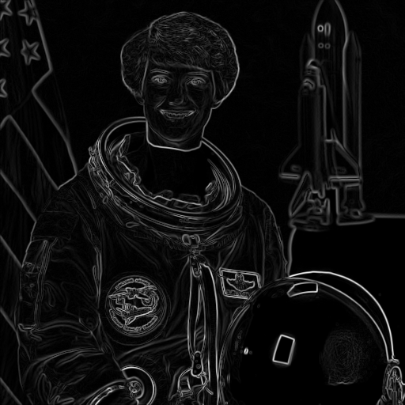
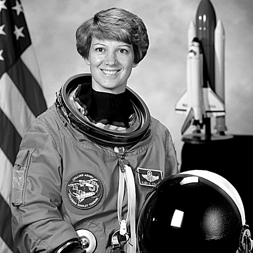

# Лабораторна робота №7: Згортка зображень
**Дисципліна:** Розробка мультимедійних застосунків  
**Спеціальність:** 122 Комп'ютерні науки  
**Група:** КН-3/1  
**Студент:** Довмат Максим  

---

## 1. Опис роботи
У цій лабораторній роботі реалізовано алгоритм двовимірної згортки зображень (`conv2`) з обробкою країв методом дублювання межі (`mode='edge'`), а також його роздільну версію (`conv_sep`).

Реалізовано три фільтри:
1. **Розмиття за Гаусом** (ядро 7x7, sigma=1.6)
2. **Оператор Собеля** (пошук вертикальних та горизонтальних країв)
3. **Підвищення різкості** (Unsharp Masking)

---

## 2. Результати фільтрації

| Розмиття (Blur) | Оператор Собеля (Edges) | Підвищення різкості (Sharp) |
| :---: | :---: | :---: |
|  |  |  |

---

## 3. Таблиця замірів швидкодії
Вимірювання проводилися на зображенні розміром $512 \times 512$ пікселів (найкращий час із 5 запусків):

| Розмір ядра | Звичайна згортка `conv2` (мс) | Роздільна згортка `conv_sep` (мс) | Виграш (разів) | OpenCV `GaussianBlur` (мс) |
| :---: | :---: | :---: | :---: | :---: |
| **3×3** | 14.8 | 11.3 | 1.3× | 1.2 |
| **5×5** | 29.5 | 12.0 | 2.5× | 1.5 |
| **9×9** | 85.8 | 17.2 | 5.0× | 2.4 |
| **15×15** | 217.2 | 33.3 | 6.5× | 4.7 |
| **31×31** | 1053.6 | 48.0 | 22.0× | 10.4 |

* **Максимальна розбіжність результату з OpenCV:** $\approx 2.55 \times 10^{-13}$ (на межі точності `float64`).

---

## 4. Відповіді на запитання до захисту

### Запитання 3: Чому в ядрі Собеля сума ваг дорівнює нулю? Що воно дає на рівному тлі й чому?
Оператор Собеля шукає першу похідну (просторовий градієнт) яскравості. На рівному однорідному тлі значення сусідніх пікселів однакові ($C$). Зважена сума дорівнює $C \cdot \sum K = C \cdot 0 = 0$. Тому на рівних ділянках результат завжди дає чорний колір (0). Перепади яскравості на межах об'єктів створюють ненульовий результат, виділяючи контури.

### Запитання 5: Чому виграш роздільного ядра на 3×3 майже нульовий, а на 31×31 — одинадцятикратний і більше?
Для ядра $N \times N$ звичайна згортка потребує $N^2$ множень на піксель, а роздільна — лише $2N$:
* Для **3×3**: $3^2 = 9$ операцій проти $2 \times 3 = 6$ (теоретичний виграш $1.5\times$). Оверхед Python на створення масивів і два проходи нівелює різницю.
* Для **31×31**: $31^2 = 961$ операція проти $2 \times 31 = 62$ (теоретичний виграш $15.5\times$). Тут складність обчислень суттєво переважає службові витрати інтерпретатора.

### Запитання 6: Результат збігається з OpenCV до нуля, але час відрізняється вдесятеро. За рахунок чого?
OpenCV написаний на C++ та високооптимізований:
1. **SIMD-векторизація:** Використання специфічних інструкцій процесора (AVX2, AVX-512).
2. **Паралелелізм:** Автоматичне розпаралелювання обчислень на всі ядра CPU (OpenMP/TBB).
3. **Кеш-оптимізація (Tiling):** Обробка блоків зображення, що повністю вміщуються у швидкий кеш L1/L2 процесора.
